<div align="center">


# Focus Keeper

**A Chrome extension that helps you stay on topic while learning on YouTube.**

[](https://github.com/pritom-banik/Focus-Keeper/actions/workflows/ci.yml)


<br/>

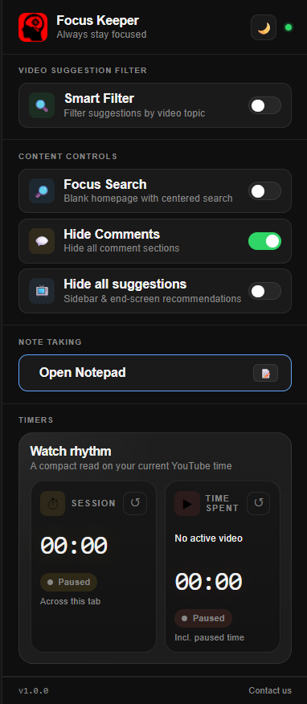

</div>

## Why we built this

Most of us have been there. You open YouTube to watch a lecture on linear algebra, and twenty minutes later you're watching a video about someone building a satellite in their backyard. The lecture is still sitting in another tab, half finished.

That isn't really a willpower problem. YouTube's recommendations are designed to keep you watching, not to keep you learning, so the sidebar fills up with whatever is most likely to get a click. As students, we ran into this constantly, and the usual fixes didn't help much. Site blockers shut YouTube out completely, which doesn't work when YouTube is where the lecture is. Keyword filters are too blunt: they can't tell that "Eigenvectors explained visually" belongs next to "Linear Algebra Lecture 12" while "I hacked MKBHD's locked phone" doesn't.

So we built Focus Keeper. Instead of matching keywords, it looks at what a video title *means*. It turns each title into a sentence embedding, compares it with the video you're watching, and quietly hides the suggestions that are off topic. Everything runs on your own machine, and no titles are sent to a third-party service.

## What it does

**Smart Filter.** This is the core of the project. When it's on, Focus Keeper compares every suggested video with the one you're watching and hides anything unrelated. Because it uses a multilingual model (BGE-M3), it works for Bangla, English, and more than a hundred other languages.

<table>
<tr>
<th>Before: whatever YouTube wants you to click</th>
<th>After: only videos related to the lecture</th>
</tr>
<tr>
<td>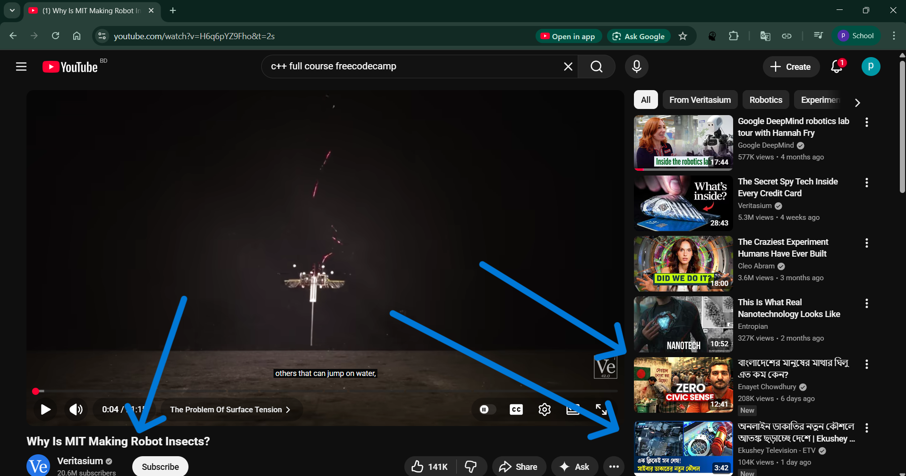</td>
<td>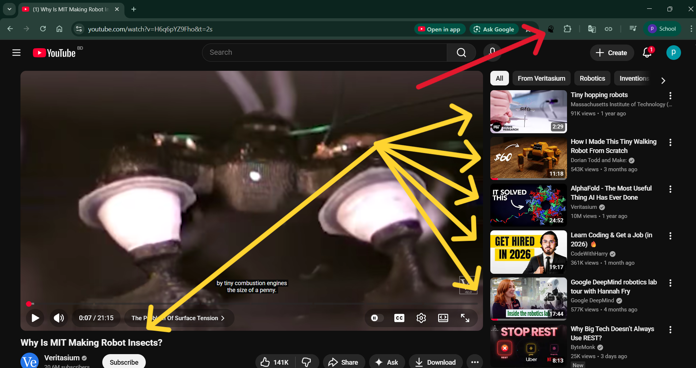</td>
</tr>
</table>

**Hide all suggestions.** Sometimes even relevant suggestions are a distraction. This switch removes the sidebar and end-screen recommendations entirely, so only the video is left.

<p align="center">
  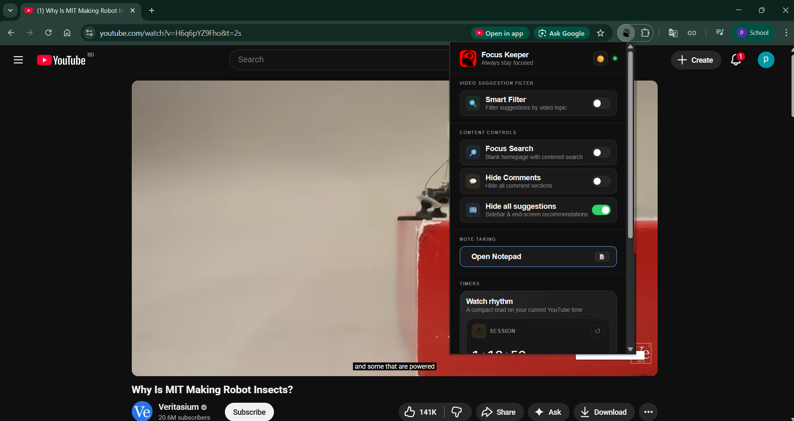
</p>

**Hide comments.** Comments can be useful, but they're also where spoilers, arguments, and off-topic threads live. You can hide them with one switch and bring them back whenever you want. Nothing is deleted; the section is just hidden on your screen.

<table>
<tr>
<th>Before</th>
<th>After</th>
</tr>
<tr>
<td>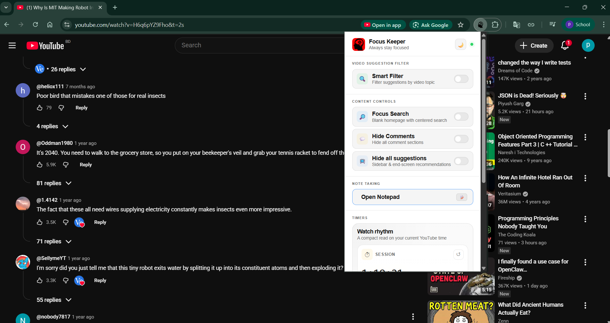</td>
<td>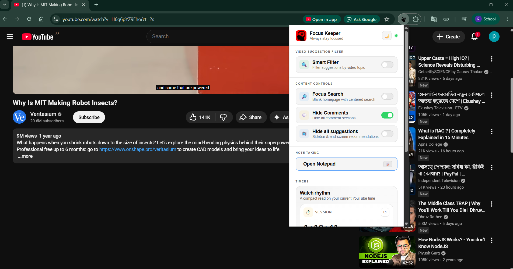</td>
</tr>
</table>

**Focus Search.** Replaces the YouTube homepage with a blank page and a search bar. You won't see a feed until you search for something, which makes it harder to get pulled in by accident.

**Notepad.** We kept switching between YouTube and a text editor to take notes, which defeated the purpose. The notepad floats on top of the video page, supports Markdown, works in fullscreen, and keeps your notes when you close the tab.

<p align="center">
  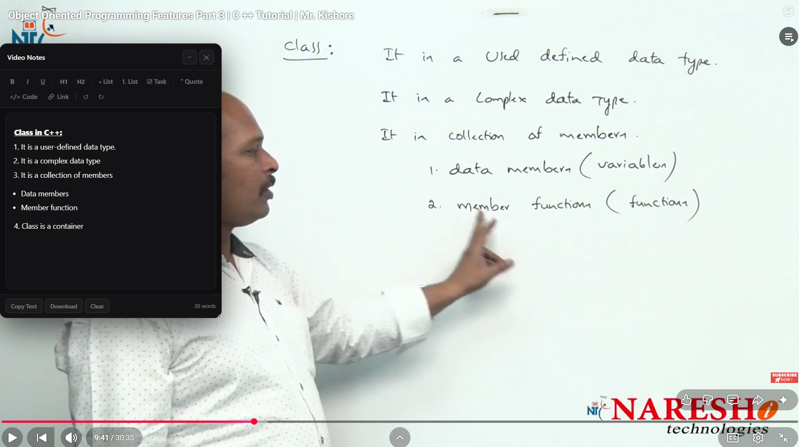
</p>

**Timers.** The session timer shows how long you've been on YouTube in total, and the video timer shows how long you've spent on the current video. Seeing the two side by side is a good reality check.

**Light and dark mode.** The popup and notepad follow YouTube's theme, so they look like part of the page rather than something bolted on.

<table>
<tr>
<th>Timers</th>
<th>Light mode</th>
<th>Dark mode</th>
</tr>
<tr>
<td align="center">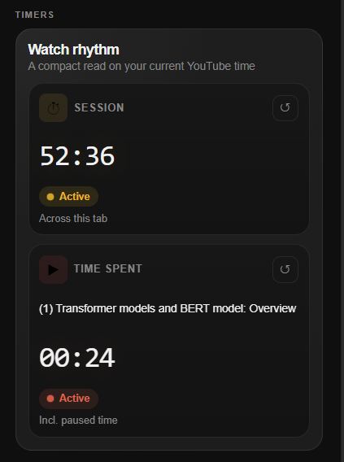</td>
<td>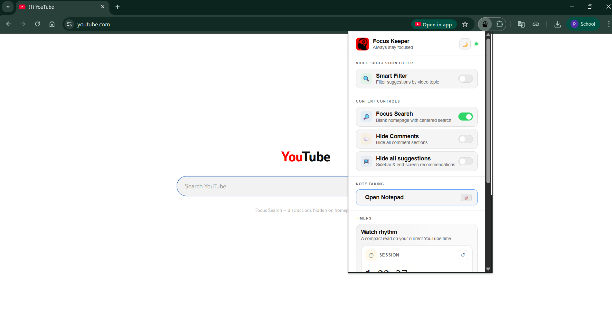</td>
<td>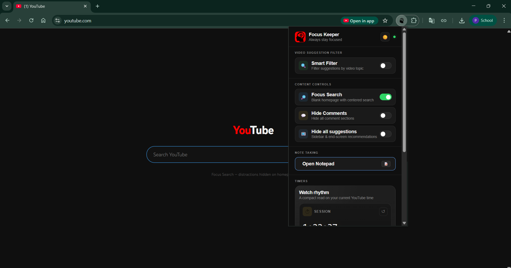</td>
</tr>
</table>

## How it works

<p align="center">
  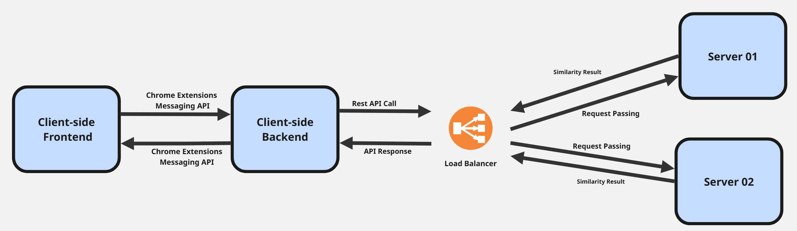
</p>

The system is split into three parts, and each one has a single job.

1. **The content script** (`content.js`) lives inside the YouTube page. It watches the page with a `MutationObserver`, picks up the title of the current video and the titles of the suggestions as they load, and hides or shows them based on the answers it gets back. We kept it deliberately light, because heavy work here would make YouTube itself feel slow.
2. **The background service worker** (`background.js`) sits in the middle. A content script can't talk to an outside server directly, so it passes the titles here through Chrome's messaging API. The service worker sends them to the server and passes the decisions back.
3. **The server** (`server.js`) does the actual thinking. It asks a local Ollama instance running BGE-M3 for an embedding of each title, then compares the two vectors with cosine similarity. We run three copies of it with PM2 and put NGINX in front as a load balancer, because a single YouTube page can produce dozens of comparison requests at once.

<p align="center">
  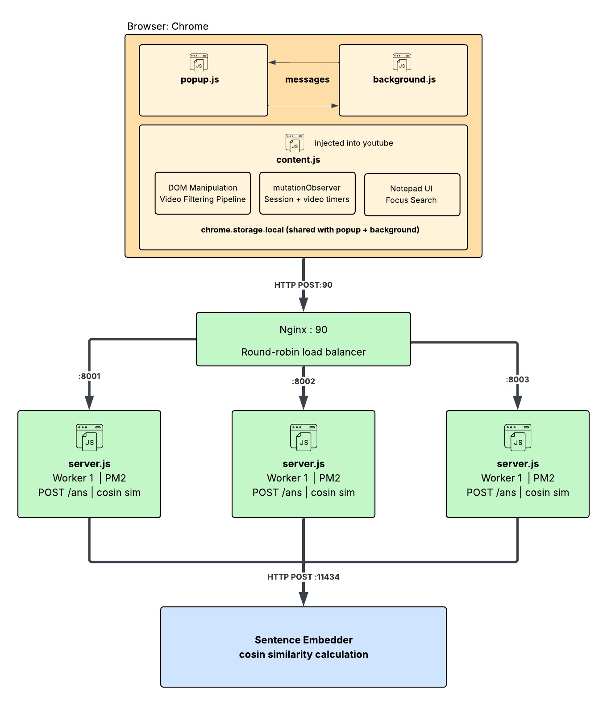
</p>

Here is the same flow as a sequence diagram:

<p align="center">
  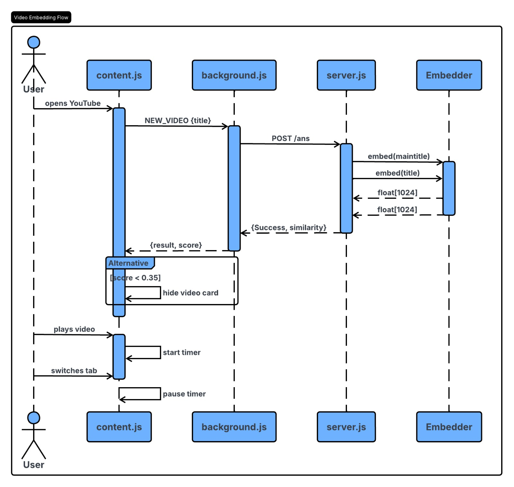
</p>

<details>
<summary><b>Activity diagram</b></summary>
<br/>
<p align="center">
  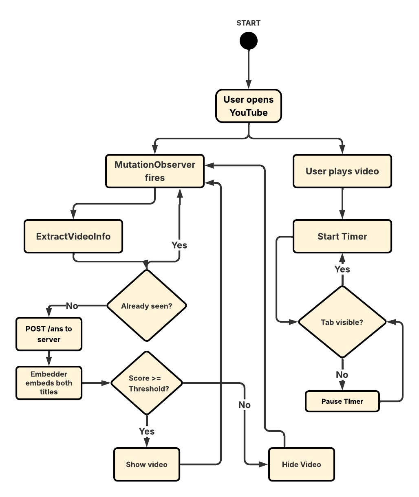
</p>
</details>

### Deciding what is relevant

Two titles are compared with cosine similarity:

$$
\text{Similarity}(A, B) = \frac{A \cdot B}{\lVert A \rVert \, \lVert B \rVert}
$$

If a suggestion scores **0.35 or higher** against the current video, it stays. Anything below that is hidden. The threshold is meant to be low enough to keep loosely related videos and high enough to remove ones that have nothing to do with the topic.

If the server is down or slow to answer, the extension leaves the suggestion visible. We'd rather show a distracting video than break YouTube for someone.

### Why we run the model locally

We started out considering a cloud embedding API, but decided against it for three reasons. Sending every title a user sees to someone else's server felt wrong from a privacy point of view. A cloud API would add a recurring cost and rate limits. And running locally means the project keeps working even if some external service changes or disappears. BGE-M3 is open source, handles many languages, and runs fine on an ordinary laptop with enough RAM.

## Getting it running

You'll need:

- **Node.js** 16 or later
- **Google Chrome**
- **[Ollama](https://ollama.com/)** for running the embedding model
- **PM2** (`npm install -g pm2`) and **NGINX** for the load-balanced setup

BGE-M3 needs at least 8 GB of RAM, and 16 GB is more comfortable. It runs on a CPU, but a GPU makes filtering noticeably faster.

**1. Get the model**

```bash
ollama serve
ollama pull bge-m3:latest
```

**2. Start the server**

```bash
git clone https://github.com/pritom-banik/Focus-Keeper.git
cd Focus-Keeper/server
npm install
pm2 start ecosystem.config.js
```

This starts three instances, on ports 8000, 8001 and 8002.

**3. Start NGINX**

The extension sends its requests to `http://localhost:90/ans`, which is NGINX, so it needs to be running. Copy [server/nginx.conf](server/nginx.conf) into your NGINX config folder and reload it:

```bash
nginx -s reload
```

If you only want to try things out and don't care about load balancing, you can skip PM2 and NGINX. Run `npm start` (one instance on port 8000) and change the `/ans` URL in [background.js](Focus%20Keeper/scripts/background.js) from `localhost:90` to `localhost:8000`.

**4. Load the extension**

Open `chrome://extensions/`, turn on Developer mode in the top right, click **Load unpacked**, and choose the [`Focus Keeper/`](Focus%20Keeper/) folder. Then open any YouTube video, click the extension icon, and turn on Smart Filter.

## The API

The server has one real endpoint. `POST /ans` takes the current video title and a suggested title:

```json
{
  "maintitle": "Linear Algebra Lecture 12: Eigenvalues",
  "title": "Eigenvectors explained visually"
}
```

and answers with the similarity score and whether the video should stay:

```json
{
  "Success": true,
  "similarity": 0.71
}
```

`Success` is `true` when the score is at least 0.35. There is also a `GET /` route that shows a simple status page, which is handy for checking that an instance is up.

## Where things are

```
Focus-Keeper/
├── Focus Keeper/              The Chrome extension
│   ├── manifest.json
│   ├── popup.html, style.css  The popup UI
│   ├── images/
│   └── scripts/
│       ├── background.js      Talks to the server
│       ├── content.js         Runs on YouTube: filtering, notepad, timers
│       └── popup.js           Popup logic and saved settings
│
├── server/
│   ├── server.js              Embeddings and cosine similarity
│   ├── ecosystem.config.js    PM2 setup for three instances
│   └── nginx.conf             Load balancer on port 90
│
└── Resources/                 Project report, diagrams and screenshots
```

## If something isn't working

- **Every suggestion is still showing.** The extension probably can't reach the server, so it's leaving everything visible. Check that NGINX is running on port 90 and that `pm2 list` shows all three instances online.
- **The server logs show Ollama errors.** Make sure `ollama serve` is running and that `ollama list` includes `bge-m3:latest`.
- **A setting doesn't seem to apply.** Refresh the YouTube tab after changing it.
- **Filtering feels slow.** Embedding is the expensive part. Check how much CPU and memory Ollama is using; a GPU helps a lot.

## What it can't do yet

We're honest about the rough edges. Right now Focus Keeper only looks at video titles, so a vague or clickbait title on a genuinely useful video can get it wrong. It only works in Chrome on desktop. And because every comparison goes through the server, there's a short delay before suggestions get filtered.

Things we'd like to add next:

- Using transcripts, descriptions and thumbnails, not just titles, to judge relevance
- Versions for Firefox, Edge and mobile
- A dashboard showing your focus patterns over time
- A relevance threshold that adapts to each user
- A job queue on the server to handle more requests at once

## Project report

Focus Keeper was built as our CSE 3200 System Development Project. The full report covers the background research, design decisions, implementation details, and a look at the ethical, legal and social side of the project:

**[Read the project report (PDF)](Resources/System_Project_Documentation/System_Project_Report.pdf)**


## Who we are

<div align="center">

**Arafat Islam** and **Pritom Banik**<br/>
Department of Computer Science and Engineering<br/>
Khulna University of Engineering & Technology (KUET), Bangladesh

Supervised by **Mr. Md. Sakhawat Hossain**, Assistant Professor, Department of CSE, KUET


</div>

We're grateful to our supervisor for their guidance throughout the project, and to our friends and families for putting up with us during the long nights.

