::: titlepage
**CSE 3200: System Development Project**

**Focus Keeper: A Chrome Extension for\
YouTube for Increasing Productivity**

**By**

**Arafat Islam**

Roll: 2107044

**&**

**Pritom Banik**

Roll: 2107052

{width="20%"}

**Department of Computer Science and Engineering**

**Khulna University of Engineering & Technology**

**Khulna 9203, Bangladesh**

**April, 2026**
:::

:::::: titlepage
**Focus Keeper: A Chrome Extension for YouTube for Increasing
Productivity**

By

**Arafat Islam**\
Roll: 2107044\
&\
**Pritom Banik**\
Roll: 2107052

:::: flushleft
**Supervisor:**\

::: minipage
**Mr. Md. Sakhawat Hossain**\
Assistant Professor\
Department of Computer Science and Engineering\
Khulna University of Engineering & Technology
:::
::::

::: flushright

------------------------------------------------------------------------

\
Signature
:::

Department of Computer Science and Engineering\
Khulna University of Engineering & Technology\
Khulna 9203, Bangladesh

**April, 2026**
::::::

# Acknowledgement {#acknowledgement .unnumbered}

We would like to express our gratitude to the Supreme Being for giving
us the courage and capacity to complete the project successfully. We are
grateful to our project supervisor, whose priceless guidance, perceptive
criticism, and consistent encouragement gave us the clarity and guidance
we needed to effectively address the challenges of this project. We also
extend our heartfelt appreciation to our beloved families and friends,
whose constant encouragement, patience, and understanding were a source
of strength during the long hours and stressful periods of this
endeavor.

::: flushright
**Authors**
:::

# Abstract {#abstract .unnumbered}

Focus Keeper is a comprehensive and production-grade productivity
extension for the Chrome browser, which helps by minimizing distractions
on YouTube by intelligently filtering video suggestions and content
elements. The system basically uses 'Sentence Embedding' and the 'Cosine
Similarity' algorithm to filter suggested videos based on the content of
the current video. If the content of a suggested video is not compatible
with the current video, it automatically hides that video from
suggestion. The project is built on a combination of Manifest V3
architecture and Node.js backend. For embedding sentences, the 'BGE-M3'
multilingual sentence embedder is used. To handle the server load,
modern technologies like open-source process manager PM2, NGINX as a
load balancer are used. The main features of this project are smart
filtering of suggested videos, integrated note-taking support, custom
control over video suggestions, and comment sections. Focus Keeper is
not just a simple ad-blocker or content filter; it is a personal
learning assistant. It transforms YouTube into a distraction-free
platform, which is especially useful for students, researchers, and
professionals.

# Introduction

## Introduction

In the modern age, keeping our focus on a specific task for a long time
is one of the biggest challenges. Research shows that the average
attention span of humans is decreasing day by day, which is very
alarming. There is a much-discussed study by Microsoft. According to
which, the average attention span of humans was 12 seconds in 2000,
which had fallen to just 8 seconds by 2023[@insights2015attention]. This
has further diminished in the current era of short-form content like
reels, short videos, etc. We are now more addicted to rapidly changing
information than to deep thinking and deep work.

## Background

YouTube is one of the biggest video-sharing platforms in the world. Many
educational videos are available there. So, students and knowledge
seekers use this platform to earn knowledge. But despite having robust
educational content, YouTube is also a major source of distraction. Its
algorithm is designed such that users are stuck on the screen for a long
time. Suppose one may have entered to watch an educational video on a
certain topic, but flashy thumbnails or entertaining videos in the
sidebar try to distract from the main goal. This is called \"Rabbit Hole
Effect\" where the user starts with a simple query but gets absorbed
into a chain of related, distracting content, which often leads toward
unintended diversion of time and focus [@keijzer2026anatomy]. This is
reducing productivity and hindering the achievement of long-term goals.\
There are several systems or tools currently available on the internet
to resolve this problem. For example, website blockers, YouTube's own
'digital wellbeing' tools, and various focus mode technologies. However,
the effectiveness of these conventional systems is very limited, and
they have several limitations. First, most solutions, like browser
extensions or website blockers, are very rigid. They simply block the
entire website, making it impossible to use YouTube even for study
purposes, which is very ineffective for a student's primary purpose.
Secondly, YouTube's own control system or reminder system relies on the
user's willpower. But once the user enters the rabbit hole and is
trapped in the circle of dopamine release, it becomes very inefficient
because the systems are unable to change the user's psychological state.
Thirdly, almost all the existing systems are passive in nature, which
means that they don't directly help users. They just limited the usage
of YouTube or limited the usage type, which doesn't affect much. And
also, this system fails to understand the context. They can't
differentiate between an educational video and an entertainment video.
Instead, they block all or release all. As a result, instead of
increasing awareness or psychological balance, these systems only create
temporary obstacles that don't play a significant role in the
productivity of a user.

## Problem Statement

Although YouTube is considered the largest and most open educational
platform in the world today, its underlying technical structure and
design philosophy often conflict with the actual goal of user education.
When YouTube is used as an educational medium, its 'Recommendation
Engine' often becomes a curse rather than a blessing. The first main
problem of the recommendation engine of YouTube is that it distracts
user attention by suggesting a large number of irrelevant and clickbait
videos next to the educational videos. When a student watches a video to
understand a complex scientific topic, the clickbait videos in the
sidebar distract them and try to destroy their depth of attention. There
are also a vast number of videos on YouTube that create information
overload, which is very tiring and confusing for a student. It becomes
confusing for them to find accurate and quality educational content and
maintain a steady focus on it. Moreover, irrelevant comments and sidebar
elements create additional pressure on the brain, which reduces the
quality of learning and also distracts attention. There is another small
but annoying point that one has to use a separate app or notebook to
write down important information while watching videos, and every time
one has to switch to applications, repeated transitions between full
screen and normal screen become a source of annoyance. This makes one
slow and hinders the overall learning process.

## Objectives

The main objective of the Focus Keeper project is to transform YouTube
into an effective learning platform through a combination of technology
and user experience.

1.  To understand the semantic meaning of suggested videos instead of
    just keyword matching and filter them according to need.

2.  To give users full control so they can turn on or off suggested
    videos, sidebars, and end-screen elements as needed

3.  To make a scalable system using modern technologies like NGINX load
    balancer and PM2 process manager.

4.  To make a simple user interface for ordinary users without any
    complicated configuration.

## Scope

Focuskeeper is a specialized productivity system that mainly helps to
keep the user focused at the time of learning something on YouTube. It
is designed in such a way that the user can block irrelevant videos and
get rid of the rabbit hole effect, making YouTube an effective
educational tool. The system is mainly divided into two parts:

- **Code extension (frontend):** It mainly runs on the user's browser
  and directly changes the interface of the user. It injects into the
  pages of YouTube and gives the flexibility to hide the comment sidebar
  and suggested videos. It provides a control panel. Moreover, it also
  gives the scope of maintaining notes without changing the tab or
  applications. The frontend is based on the manifest V3 version. The
  frontend is built on HTML, CSS, JavaScript, and the Chrome runtime
  api.

- **Node.js Backend(Server):** The core component of the extension is
  the Node.js backend. It is made to find the semantic similarity
  between the current video and the suggested video. It is mainly a
  server built on Express, which exposes a POST API endpoint. There is a
  sentence embedding model named BGE-M3, which runs on Ollama,a locally
  deployed model runner, that helps to embed the titles of the videos.
  The backend is built using Node.js, Express, and a REST api.

## Modern Tools and Technologies

Modern tools and technologies that are used while developing the
project:

- **Chrome extension platform:** for interacting directly with the
  browser's DOM

- **Manifest V3:** the latest and mandatory configuration for Google
  Chrome extensions for security, privacy, and background resource
  efficiency

- **HTML:** for extensions, pop-up windows, and the structure of the
  notepad

- **CSS:** for designing purposes

- **JavaScript:** the main logic engine of the project that helps to
  manipulate the DOM, make API requests, etc.

- **Chrome Extension API:** helps to connect the whole system in real
  time and store data in local memory

- **Node.js:** a backend runtime environment

- **Express:** a modern, powerful web framework for API routing, HTTP
  request handling, and REST API

- **REST API:** A protocol for connections between the extension and the
  server

- **BGE-M3:** Embedding model: a multilingual sentence embedding model

- **Ollama:** A local model runner engine that helps to run the model
  locally without any API

- **PM2:** a production-ready process manager for ensuring the high
  availability of the server

- **Nginx:** works as a reverse proxy and load balancer in the server

## Unfamiliarity of the Problem

The project is designed to address a problem that is very common in the
modern digital age. But a widely established, effective, and intelligent
solution has not yet been found for it. There are many research studies
and tools available that address the YouTube distraction or "Rabbit Hole
Effect," but they often provide the simplest solution. Whether they use
approaches like removing the whole content, or they restrict the usage
of the service fully for a certain amount of time. But in this project,
the problem's solution is approached from a completely different angle.
Here, the solution is based on factors like "Learning VS Entertainment"
and the semantic relevance of the content. This type of semantic
understanding-based solution is not taken from any existing tool.
Rather, it is a new idea where relevance and semantic meaning between
the currently playing video and videos in the suggestion list are
determined by sentence embedding and cosine similarity.

\
**Problem Perspective:** This project did not view YouTube as a source
of distraction. Rather, it viewed it as an attention engineering
problem. The goal was to make the attention structured and controlled
instead of removing the distraction completely.

**Technical Approach:** This project uses a different stack of
technology. This stack choice does not take exactly from other existing
tool stacks. A context-aware filtering system makes it unique among

**System Design and Architecture:** This system is not limited to a
simple extension; rather, it has been designed as a multi-layered system
where client-side extension, client-side backend, and server-side
processing layer work together.

**Feature Integration:** Another important and unique part of this
system is the feature set. It is not only a video filtering platform,
but it also offers features like hiding distractions completely(both
suggested video and comments), note-taking, session timer, video timer,
etc.

**Solution Philosophy:** The core philosophy of the project is different
from other existing solutions. It is not a restrictive system, but
rather an assistive system. Here, the user is not completely isolated
from the content. It tries to achieve an approach where the user is
guided to have a structured and controlled attention. That makes the
project a unique and innovative solution.

## Project Planning and Work Distribution

Effective project management was very crucial for successfully
developing the project \"Focus Keeper\".The project management is shown
in a Gantt chart in Fig \[[1.1](#fig:gantt-chart){reference-type="ref"
reference="fig:gantt-chart"}\], which visually represents the System
Development Life Cycle, allowing us to see the start and end periods of
the entire project at a glance. The schedule includes the following
stages: project Identification and feasibility study, requirement
analysis, design(System design, UI/UX design), implementation, testing,
optimization, and documentation. This scheduling format makes it easy to
understand dependencies between tasks.

<figure id="fig:gantt-chart" data-latex-placement="h">
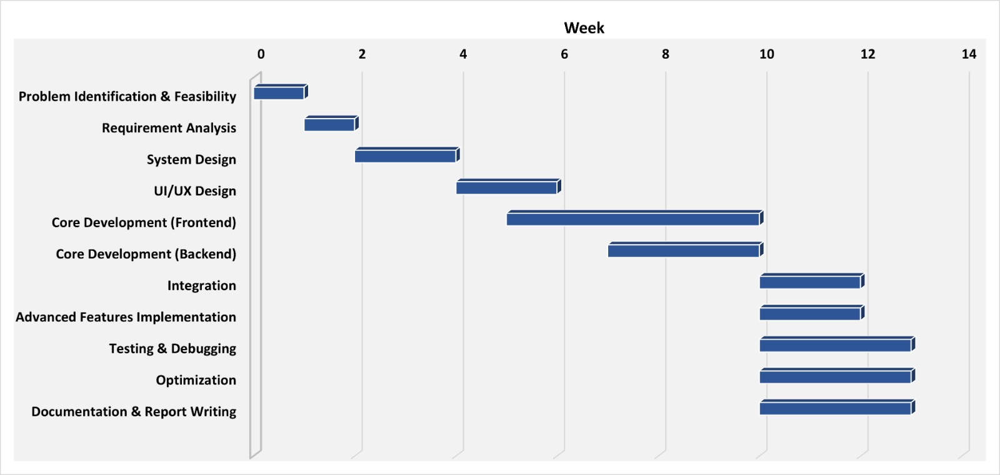
<figcaption>Project GANTT Chart.</figcaption>
</figure>

### Project Management Approach

We followed the Agile approach for completing the project. The main
reason for choosing this method is its flexibility over the traditional
waterfall model.YouTube is a dynamic platform, and its DOM structure
changes frequently. Besides, various technical challenges can arise
during the sentence embedding model implementation. The Agile
methodology allowed us flexibility to review the work at the end of each
step and make the changes quickly if necessary. The work process was
incremental. Small goals were set, implemented in code, and tested. In
this process, the progress was evaluated every week, and a goal was set
for next week.

### Work Plan:

The project was structured into five different phases from 1st week of
the semester to the 13th week of the semester. This timeline was
visualized using a Gantt chart to track progress, manage dependencies,
and ensure key milestones were met. The Gantt chart provides a
week-by-week, precise breakdown of the project flow.\
**Step 1: Project Identification and Feasibility Study:**\
The first week was for generating and selecting ideas for
implementation. The practical implementation of the proposed ideas was
also studied. The project idea was selected by analyzing the attention
behaviour and the needs of the present situation. Then study the
feasibility of solving the problem using modern technologies. The scope
of modern technologies was also measured.\
**Step 2: Requirements Analysis:**\
In this step, the system requirements were identified in the 2nd week.
The requirements were categorized into:

- *Functional Requirements:* Define features for video filtering,
  note-taking, and sidebar control.

- *Non-functional Requirements:* Ensure system response time, security,
  and make the user interface simple.

- *Similarity Threshold Determination:* Initial research into the value
  of cosine similarity and select a threshold for determining whether a
  suggested video is relevant to the current video.

\
**Step 3: Design Phase:**\
The blueprint of the system was created in this step from the 3rd week
to the end of the 7th week. The system design includes architecture
design, UI design, database, and storage plan. The design phase was
split into two key design components:

- *System design:* The blueprint of the system architecture was
  developed, focusing on the scalable communication between the browser
  extensions and the Node.js backend server. Database and storage plans
  were finalized here, and the communication protocol was also
  developed. The required stack for implementing the project was also
  decided in this step.

- *UI/UX Design:* In this step, the main focus was on creating an
  intuitive and simple user interface. This involved designing the
  pop-up panel and the notepad to ensure that the user feels a native
  look in the extension and feels consistent with YouTube's design.

\
**Step 4: Implementation and Coding:**\
This was the most important as well as the longest phase of the whole
project development. It involved the actual implementation of the
system. All the planned designs and requirements were converted into the
working application in an incremental way. Core functionalities were
built step by step and integrated to build the whole system.

- *Backend Development:* Server was implemented using Node.js,
  integrated Ollama for local Sentence Embedding, PM2 was implemented
  for production process management, and NGINX was implemented as a load
  balancer. A multilingual embedding model was integrated on the server
  side to generate vector embedding. Implemented the cosine product
  between the current running video title and the suggested video title
  to determine the similarity.

- *Frontend and Content Script:* The extension frontend was implemented
  using HTML and CSS. JavaScript was used to capture the element of the
  YouTube page and send it to the background worker, and from the
  background worker to the server.

- *Integration:* At the last stage of backend and frontend development,
  the distributed frontend and backend were combined to make an
  effective ecosystem. This phase is not only about combining them but
  also about making the experience seamless.

- *Advanced Feature Implementation:*To take the system out of a normal
  blocker, making it a smart, productive tool. Some advanced features
  had been added to it, like a persistent Notepad, which is implemented
  in such a way that the user can take notes even if the video is played
  in full screen. There is a dynamic theme adaptation for Dark Mode and
  Light Mode. A session tracker was also added for the user to track
  their entire YouTube session and track the total watch time of a
  video.

\
**Step 5:Testing, Optimization and Documentation**\
In the last three weeks, the quality of the system was ensured. It was
checked whether the extension works properly in different browsers and
on different YouTube pages. There was also an attempt to optimize the
system to be more scalable and smooth. The project documentation and
project slides were prepared.

### Work Distribution

The project is done by the team of two students: Arafat Islam (Roll:
2107044) and Pritom Banik(Roll: 2107052). The team's commitment and
proper task distribution played a crucial role in completing the project
on schedule.

  **Work Areas**                                                                          **Primary**    **Secondary**
  --------------------------------------------------------------------------------------- -------------- ---------------
  Project idea, requirement analysis and report planning                                  Both members   --
  Primary structure of the extension, manifest file and overall setup                     Pritom Banik   Arafat Islam
  YouTube DOM Manipulation, suggested videos hiding/filtering logic                       Both members   --
  Design popup UI, theme changer, dark/light mode and user interaction                    Arafat Islam   Pritom Banik
  Timer feature, focus search homepage and popup behavior update                          Arafat Islam   Pritom Banik
  Video note-taking/sticky notepad feature                                                Arafat Islam   Pritom Banik
  Backend Server development, API endpoint and server-side similarity model integration   Pritom Banik   Arafat Islam
  Ollama 'bge-m3' embedding model integration and cosine similarity based filtering       Pritom Banik   Arafat Islam
  Server Refactoring, Stateles server design and codebase restructuring                   Pritom Banik   Arafat Islam
  PM2 milt-instance setup and NGINX load balancer configuration                           Pritom Banik   Arafat Islam
  README, local setup guide, deployment/configuration documentation                       Pritom Banik   Arafat Islam
  Testing, debugging, final integration and final documentation                           Both members   --

  : Work Distribution Among Team Members

## Application of the Work

The Focus Keeper project has a very broad scope of application, and it
can serve as an effective solution for a wide range of users according
to their interests and work patterns. Primarily, it is a powerful tool
for students and researchers who use YouTube as a learning medium for
their daily work. Using this product, they can focus on a specific topic
while reducing topics that can distract them from what they wanted to do
in the first place. Also, this application is particularly useful for
users who follow online courses or tutorials, as it can help them
maintain continuity in their learning. This project also has the
potential to expand to different platforms in the future, such as mobile
applications or integration into other video platforms.

## Organization of the Project

To make the reader understand each step and concept, the project report
is presented in a well-structured way.\
**Chapter 1** discusses the introduction, background, problem statement,
objectives, and technologies used, which provides an overview of the
entire project.\
**Chapter 2** analyzes previous research and existing solutions and
highlights their limitations. This helps clarify the need for new
solutions.\
**Chapter 3** explains the project methodology and system architecture
in detail. This highlights the data flow, different layers, and system
functionality.\
**Chapter 4** presents the details on technologies used, implementation
details, and discussion. This helps in evaluating the project
effectively.\
**Chapter 5** gives insights on leagal, ethical, and environmental
aspects. This helps understand the actual impact of the project.\
**Chapter 6** explains complex engineering activities related to the
project, and lastly,\
**Chapter 7** discusses the project summary, limitations, and future
work opportunities. This explains the future development scope of the
project.\

# Related Work

## Introduction

In this modern world, it has become hard to keep attention span during
work because there are a lot of distractions. On the YouTube platform,
there is educational content on one side and a whole other
attention-grabbing content on the other side. And the recommendation
system makes users drift away from what they had started in the first
place. To solve this problem, there are already many tools available
that mainly reduce distraction and increase productivity. But the
existing solution has a lot of limitations, and the solution that it
provides is also not up to the level where it makes the user extremely
productive. In this chapter, we will cover previous works and their
limitations analysis, and discuss how our proposed "Focus Keeper" is a
unique and upgraded approach.

## Related Work

The problem of maintaining attention and removing unnecessary
information from internet platforms like YouTube has long been the
subject of research and technology development. There are some popular
Chrome extensions, for example: \"Unhook - Remove YouTube Recommended &
Shorts\"[@unhook].It is one of the most popular Chrome extensions that
hides YouTube's feed, sidebar, and comment section completely. Another
is \"DF Tube\"[@dftube].This gives the option to the user to choose
whether they want to see the home feed or keep the playlist sidebar. It
brings a minimalist look to YouTube. Next, there are AI-based video
summarizers like \"Eightify: AI YouTube Summarizer\"[@eightify]; while
not directly hiding suggestions, these tools use AI to generate video
summaries.

To understand the relevance of the Focus Keeper project, we have divided
existing solutions into some categories:

- **Static Content Blocker:** There are currently several browser
  extensions to remove distractions. These tools basically use CSS and
  JavaScript to completely hide the suggested videos or make the home
  feed, sidebar, or comment section invisible. But they are static. They
  either show all videos or close all videos, or show them all. They
  don't have the intelligence to check whether the video suggestion is
  related to the current video.

- **Productivity Tools:**There are tools like \"Cold
  Turkey\"[@coldturkey], \"Freedom\"[@freedom], which help users block
  YouTube or other social media for a specific period of time. These are
  basically time-based blockers. If a user wants to study for a longer
  time, these tools block access without realizing the necessities.

Compared to existing tools, Focus Keeper fills a specific gap:

- **Dynamic vs. Static Filtering:** Previous traditional tools block all
  suggestions, but Focus Keeper only removes irrelevant videos. This
  allows user to watch other videos according to their requirements.

- **Integrated Features:** Note-taking and content filtering are brought
  together on the same platform, which is usually not seen in any other
  extension.

- **Scalability:** It is suitable for large-scale use and durable
  because it uses Nginx as a load balancer and PM2 as a process manager.

  **Feature / Criteria**     **Static Content Blockers (Unhook, DF Tube)**   **Productivity Tools (Cold Turkey, Freedom)**   **AI Summarizers (Eightify)**     **Focus Keeper (Proposed)**
  -------------------------- ----------------------------------------------- ----------------------------------------------- --------------------------------- ------------------------------------------------------------
                                                                                                                                                               
  **Main Purpose**           Remove distractions by hiding UI elements       Block access to websites                        Summarize video content           Reduce distraction while keeping relevant learning content
  **Filtering Type**         Static (all-or-nothing)                         Time-based blocking                             No filtering                      Dynamic (semantic filtering)
  **Handling Suggestions**   Completely hides all recommendations            Blocks entire YouTube                           Does not control suggestions      Shows only relevant videos
  **Context Awareness**      No                                              No                                              Content-based summary             Uses semantic similarity
  **Flexibility**            Low                                             Low                                             Medium                            High
  **Impact on Learning**     Removes both useful & irrelevant content        Prevents access even when needed                Helps understand content faster   Keeps useful content, removes distractions

  : Comparison Between Proposed and Currently Available Tools

## Discussion

To reduce the distraction problem, on YouTube, there already exist tools
like "Unhook" or "DF Tube". But these tools hide the sidebar, homepage
feed, and comment section completely. This type of tools mainly uses CSS
and JavaScript to target specific DOM elements and make them invisible.
As a result, the user can somewhat avoid distraction. But it is a static
approach where every type of recommendation is hidden completely. As a
result, users are left out of useful content that could appear in the
suggestion section. This is a big limitation when considering the
educational factor, where it is needed to see related content with the
already consumed topic. On the other side, "Cold Turkey" or "Freedom"
blocks the whole website. Users use this type of time-based blocking
system to increase their self-control. But this depends on the user's
real-life use cases. For example, if a student wants to use this, it can
cause more inconvenience. Also, these systems do not have any context
about what users want to do or were trying to do. In this perspective,
Focus Keeper follows a different approach. It uses semantic filtering
rather than static filtering. The way it achieves that is sentence
embedding and cosine similarity. All the irrelevant and unnecessary
videos are removed from the suggestions, and only the relevant videos
are kept in the suggestions. Also features like notepad, time tracker
make it a full-fledged learning assistant.

# Methodology

## Introduction

The main goal of the Focus Keeper project is to maintain the user's
attention while using YouTube and eliminate distractions caused by
irrelevant clickbait videos or content. To achieve this goal, a novel
and secure methodology, combining a sentence embedding model and a
browser extension, has been developed, overcoming the limitation of
simple keyword matching.

At the primary stage of the system design, the main goal was to create a
mechanism that could control the YouTube interface in real time. At the
first stage, a basic architecture was built using the Chrome extension
API. At that time, the main goal was to collect data from the YouTube
page and process it. At the first stage, there was a thought to use
keyword matching or a third-party API for content filtering, but this
creates two problems: 1. The keyword matching doesn't give the proper
context. 2. Using a third-party cloud API increases the dependency and
raises privacy and data security issues.

Then the system was optimized by removing the limitation of the initial
design instead of keyword-based filtering. Thus, semantic analysis was
chosen. YouTube has content in different languages. For this reason, a
multilingual sentence embedding model was chosen for semantic analysis,
as a sentence embedding model is powerful and needs many resources, so
it was decided to transfer it to the remote server. So, a remote server
was introduced.

After analyzing and testing various models and filtering techniques, the
architecture is finalized based on remote vector embedding and cosine
similarity. For system scalability, a load balancer was added to handle
the huge api request.

## Detailed methodology

### Overview

This is a Chrome extension-based intelligent filtering system that
operates on YouTube content (i.e., recommended videos), analyzes them,
and provides meaningful suggestions to the user.

<figure id="fig:system-archi" data-latex-placement="h">
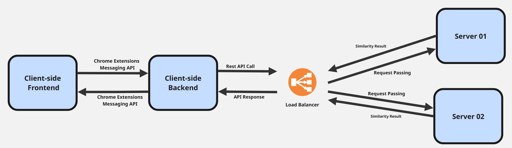
<figcaption>High-Level System Architecture </figcaption>
</figure>

The Extension has basically 3 main layers;

1.  **Client-side frontend:** This layer interacts with the user
    directly and collects data from browser information. When a user
    uses YouTube, this layer communicates with the DOM and collects data
    such that the current video title, titles of suggested videos, etc.
    Not only collecting data, but it also controls which videos to
    watch, which videos to hide, showing/hides notes. An important thing
    to mention is that this layer does not do any heavy computation.
    Because doing heavy computation makes the performance drop
    drastically. So, in short, this layer takes input (video
    information) and shows output (filtered videos).

2.  **Client-side backend:** This layer is the "Traffic manager" or
    "Orchestrator" of the system. The front-end can't interact with the
    servers. So, from the front-end, the collected data are sent to the
    client-side backend using Chrome Extensions Messaging API. After
    receiving data, it is sent to the remote server in JSON format for
    processing using api call, and the reply of the remote server comes
    here. The reply is then sent back to the front-end.

3.  **Processing layer/Server:** This layer is the brain of the system.
    Intelligent work is done here. The first each of the titles is
    converted into embeddings, meaning text to vector. Then, the
    similarity calculation is done on the vectors using the cosine
    product rule. By doing this, the system can differentiate between
    relevant and irrelevant videos with the currently playing video.
    Then it sends the result to the client-side backend. Without this
    layer, the actual smart filtering can not be done. Because of this,
    the layer system can understand semantics, not only the keyword but
    also the actual meaning.

<figure id="fig:placeholder" data-latex-placement="h">
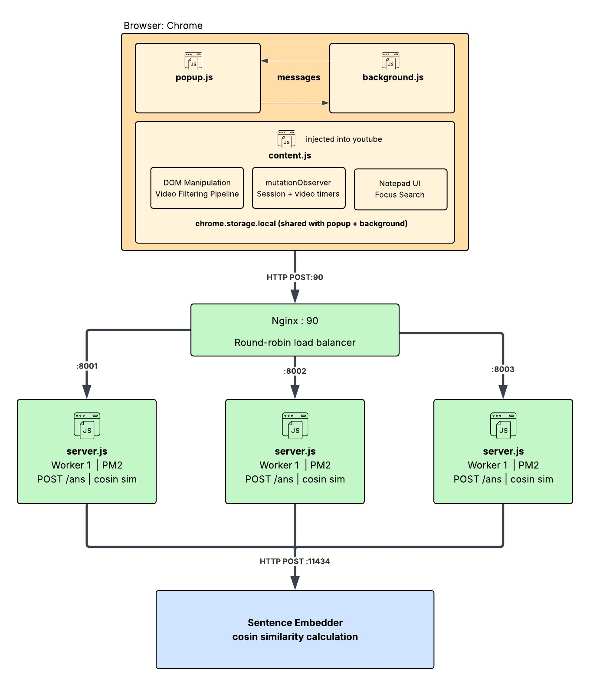
<figcaption>Detailed System Architecture</figcaption>
</figure>

### End-to-End Workflow:

\"Focus Keeper\" is a modern Chrome extension that offers a smart video
suggestion filtering system with additional features like an integrated
notebook and time tools. The architecture of this project is done in a
way that it works as an end-to-end intelligent system, where a Chrome
extension, a backend server, and a Sentence Embedding pipeline work
together. The whole system is built in a way so that whenever a user
browses YouTube and watches a video, semantic analysis is done on the
currently playing video and recommended videos to determine which videos
are relevant and which are not. The semantic analysis is done in a
remote server rather than in the browser to make the extension
lightweight, faster, and to make the whole setup scalable and reliable.\

<figure id="fig:sequencedg" data-latex-placement="h">
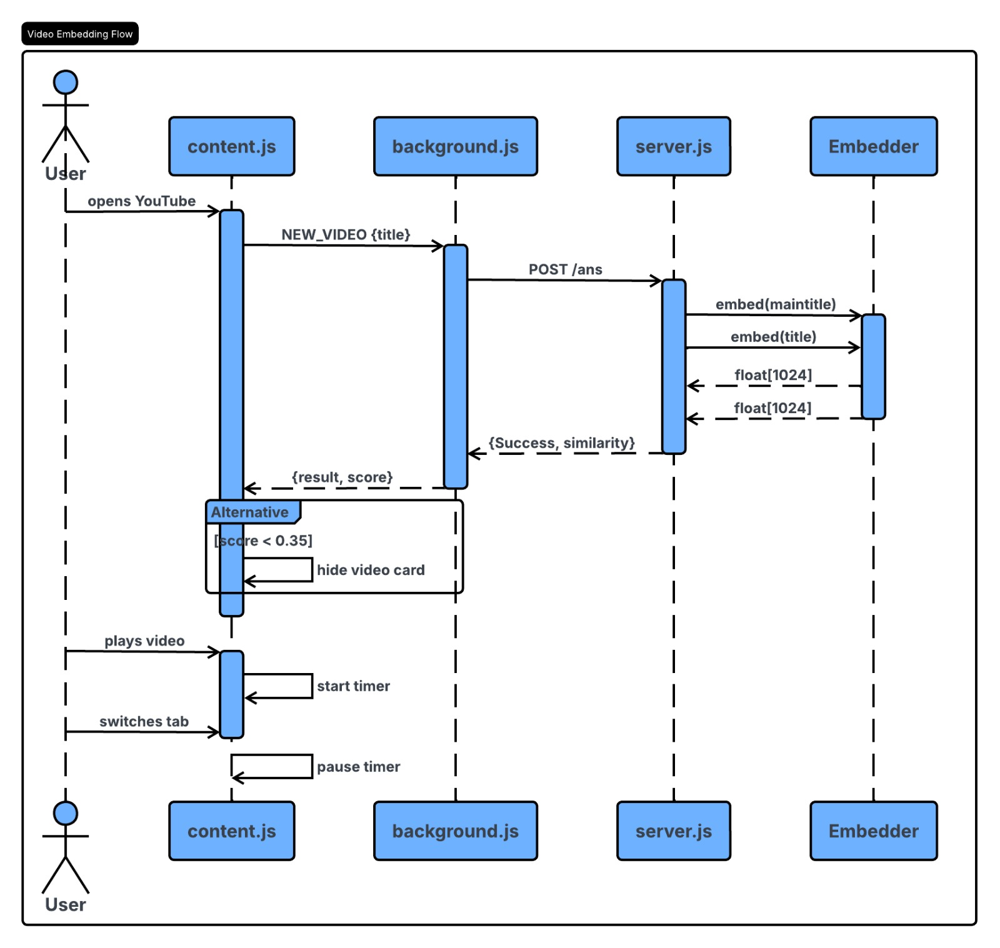
<figcaption>Sequence diagram of Focus Keeper</figcaption>
</figure>

**Data extraction and frontend layer**\
First, the system starts from the browser side, where there is 3 main
components -- Content Script, Background Service Worker, and Popup UI.
When a user opens a video on YouTube, the content script is activated
and collects information from the YouTube DOM. The information includes
the currently playing video title and the recommended video list. Using
MutationObserver, all the data is collected, and it also keeps an eye on
whether new recommended videos are loading. Content Script does not do
the heavy computation, but sends the collected data to the Background
Service Worker. This communication is done by Chrome Extension Messaging
API. The background script works as a central controller here, which
handles backend logic and communicates with the outside server.\
**Messaging and Communication**\
Background communicates with the service worker using the REST API. At
first, the current video title and the suggested video titles come from
the frontend script using Chrome Extension Messaging API. When new data
comes, it sends a POST request to the proper server endpoint, which
creates a new comparison job. Here, the video titles are sent using a
fetch request. No sensitive data is sent here; only the titles are
processed. Then, after receiving the response from the server, the
background script sends those decisions(i.e., which videos to show,
which to hide) back to the content script. Here a asynchronous
communication is implemented as generate embeddings and similarity
computation are heavy tasks that can take time. If the process were
synchronous, it could result in a delay or UI freeze, making the user
experience poor.\

<figure id="fig:activitydg" data-latex-placement="h">
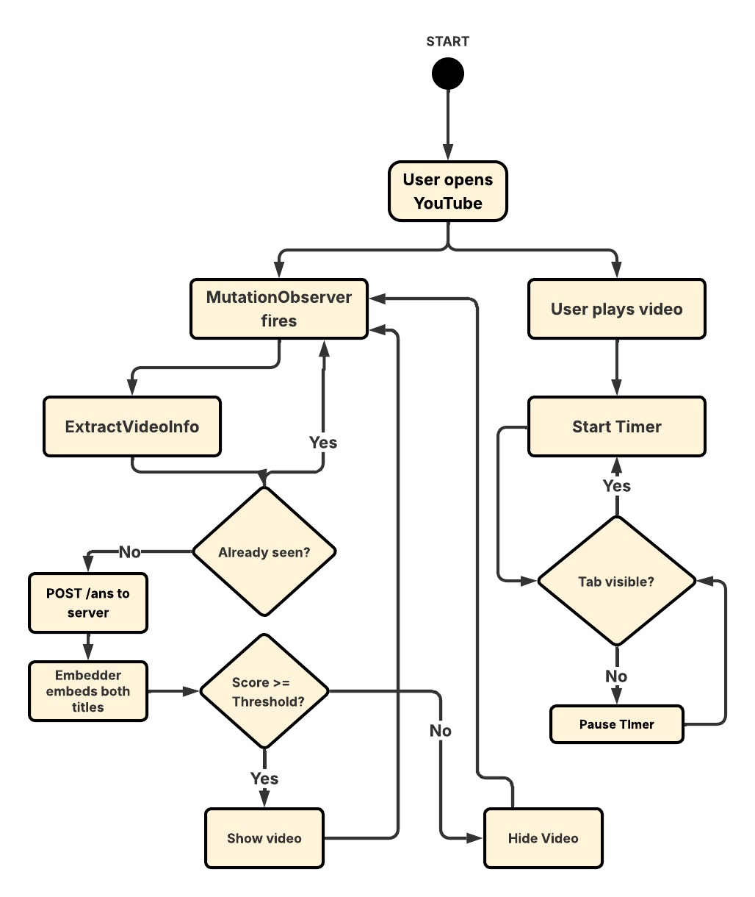
<figcaption>Activity diagram of Focus Keeper</figcaption>
</figure>

**Server Process and Decision Making**\
The layer is the brain of the entire system. An Express server in the
backend works here. It collects the current video title and suggested
video titles. Then there is a sentence embedding model. In this case, a
multilingual sentence embedding model was used, which is BGE-M3. Using
this model, it generates a sentence embedding for each title. Then the
vector is used to find the angle using cosine similarity, which gives a
value between 0 and 1. The closer the value is to 1, the more similar
the two videos are. The math is:

$$\begin{equation}
\text{Similarity} = \frac{A \cdot B}{\|A\| \cdot \|B\|}
\end{equation}$$

Then, using cosine similarity, it compares the semantic meaning of the
titles. If the cosine production goes over a certain threshold, then the
server sends a response that two videos are related,othewise will send
reponse about hiding the videos.\

## Sentence Embedding

### What is Sentence Embedding

In the world of natural language processing (NLP) and artificial
intelligence, sentence embedding is a very important topic. Sentence
embedding means the transformation of a whole sentence into a numerical
point or vector. When humans understand the human language, the computer
just understands 0 and 1. When text or a sentence is given to the
computer to understand its context, semantic meaning, and grammatical
rules, the computer transforms it into a vector of specific dimensions.
Why is it important? When a computer transforms a sentence into numerics
or a vector, it can compare them. Sentences that are more semantically
similar will be mapped together more closely in vector space. For
example:

1.  Today's weather is so good.

2.  The weather is so nice for a walk.

3.  The situation of the stock market is not good today.

The meaning of the first sentence and the second sentence is close
together, so their embedding vector will map near each other. The vector
of the third sentence will be mapped at a distance. Using this process,
I can find the semantic similarity between two sentences.

### The process of sentence embedding

The whole process of sentence embedding is done in several phases. In
modern times, for sentence embedding, the transformer architecture is
used. Example: BERT. Steps in detail;

**Tokenization:** At first, the whole sentence is converted into small
pieces or words. These are called tokens. For example, \"The cat sat\"
is three tokens: \"The\", \"cat\", and \"sat\".

**Word embeddings:** Then, each token is converted into vectors. These
are taken from the vocabulary or word dictionary of the model.

**Contextualization:** These vectors are sent into the transformer layer
for the \"self-attention\" mechanism of the transformer. Every word
understands the context of its neighbor. The bank in the sentence \"The
river bank is so nice\" is recognized differently from the sentence
\"This is the World Bank\".

**Pooling:** The transformer makes individual vectors for each word, but
we need only one vector for the whole sentence. To make two or more
vectors into one sentence, the process is called pooling. There are two
types of pulling:

- *Mean pooling:* Here, the final vector is prepared by taking the
  average of all the vectors of the words.

- *CLS token pooling:* Here, a CLS token is added at the start of each
  sentence, and using this CLS token, the sentence is represented.

## Sentence Embedding Model

The Artificial Intelligence or Machine Learning model that takes text or
a sentence as an input and, as an output, delivers a sentence embedding
vector that is called a sentence embedding model. Previously, there was
a word2vec or GloVe model that only encoded the word, but for
understanding the meaning of the sentence, there are models like Sbert
in recent times. Like that, there is a sentence embedding model, which
is the BGEM3 sentence embedding model. In recent times, among the
open-source embedding models, one of the most powerful and discussed
models is BGEM3. It is built by the famous Chinese research corporation
BAAI, the Beijing Academy of Artificial Intelligence.[@chen2024bge]

### BGE-M3 Model

The BGE-M3 model has 3 powerful qualities:

1.  *Multi-linguality:* It not only understands English but also
    understands more than 100 languages, like Bangla, English, Spanish,
    and French. If anyone asks a question in English, it can retrieve
    the similarity from other languages, such as Chinese.

2.  *Multi-granularity:* from very short sentences to huge sentences
    (highest 8,192 tokens or 6,000 to 7,000 words). This model can
    process and embed them together, whereas normal models cannot
    process more than 512 tokens.

3.  *Multi-functionality:* It can retrieve or find text using three
    functions: 1. Dense retrieval 2. Sparse retrieval or lexical 3.
    Multi-vector retrieval

### Working Methodology of BGE-M3

The model works with the combination of 3 methods:

1.  *Dense Retrieval:* This is the classic sentence embedding. It
    converts the entire sentence or document into a single-dimensional
    vector. It is very good for understanding \"meaning\" or
    \"semantics\".

2.  *Sparse Retrieval (Lexical Weight):* Sometimes it's not just about
    understanding the meaning, it's also about matching specific
    keywords. In Sparse Retrieval, the model assigns a 'weight' to each
    word in the sentence. It works much like the traditional BM25
    algorithm, but it uses a neural network to learn which words are
    more important. It works great for matching exact keywords or names.

3.  *Multi-vector Retrieval (ColBERT style):* Here, instead of one
    vector for the entire sentence, a separate vector is stored for each
    word (token) in the sentence. When a search is performed, the vector
    for each word in the document is compared with each word in the
    search.

### Device Requirement

The BGE-M3 model is very powerful, but it does not require a
supercomputer to run, but it does require good hardware. The model is
based on the XLM-RoBERTa-Large architecture.\
**Model Size:**\
*Number of Parameters:* 567M Parameters.\
*Storage Size:* roughly 2.27 GB in standard float32 precision, with
optimized versions in fp16/bfloat16 requiring around 1.06 GB\
**Inference Requirements:**\
**RAM:** *Minimum:* 8 GB of RAM. *Recommended:* 16 GB of RAM\
**GPU:** While it is possible to run this on a CPU, it will take a long
time. For production or fast work, a GPU is preferable.\
Sentence embedding is the eye of modern AI, through which it can
understand human language. And in this world, BGE-M3 is a masterpiece.
Due to its ability to understand multiple languages and its low device
requirements, it is the perfect choice for the project.

## SWOT Analysis

+----------------------------------+----------------------------------+
| **Strengths**                    | **Weaknesses**                   |
+:=================================+:=================================+
| - Intelligent Filtering:         | - Resource Heavy: Real-time      |
|   Semantic analysis (via         |   embeddings may cause lag on    |
|   bge-m3:latest and cosine       |   low-end hardware.              |
|   similarity) provides superior  |                                  |
|   contextual accuracy over       | - Fragile Integration: Depends   |
|   keyword blockers.              |   on YouTube's DOM structure,    |
|                                  |   possibilities of breaking.     |
| - Scalable & Modular: Clear      |                                  |
|   separation between Chrome      | - Accessibility: Limited to      |
|   extension (UI) and Node.js     |   Google Chrome desktop users.   |
|   server.                        |                                  |
|                                  |                                  |
| - High Relevance: Effectively    |                                  |
|   addresses YouTube distraction  |                                  |
|   (rabbit holes).                |                                  |
+----------------------------------+----------------------------------+
| **Opportunities**                | **Threats**                      |
+----------------------------------+----------------------------------+
| - Platform Expansion: Can be     | - YouTube Updates: Frequent UI   |
|   extended to Firefox, Edge,     |   changes require continuous     |
|   Safari, and mobile.            |   maintenance.                   |
|                                  |                                  |
| - Feature Integration: Can be    | - Competition: Established       |
|   integrated with tools like     |   blockers (e.g., Freedom, Cold  |
|   Notion, add AI summarization.  |   Turkey) offer simpler          |
|                                  |   alternatives.                  |
| - Market Trend: Growing demand   |                                  |
|   for digital wellness and AI    |                                  |
|   productivity tools.            |                                  |
+----------------------------------+----------------------------------+

: SWOT Analysis

# Implementation, Results and Discussions

## Introduction

Implementation is the final step in turning the theoretical concept and
system design of any project into reality. The technical development of
the entire project has been completed in two main parts: first, the
client side has been created using the Chrome Extension API, which
collects data from YouTube's dynamic interface (DOM) in real-time and
hides distracting elements according to the user's configuration.
Second, a server has been created with Node.js on the backend, where
Ollama's bge-m3:latest model has been added for completely offline
processing without relying on any third-party cloud service. Features
like the in-app Notepad and timer are also implemented.

<figure id="fig:ui" data-latex-placement="h">
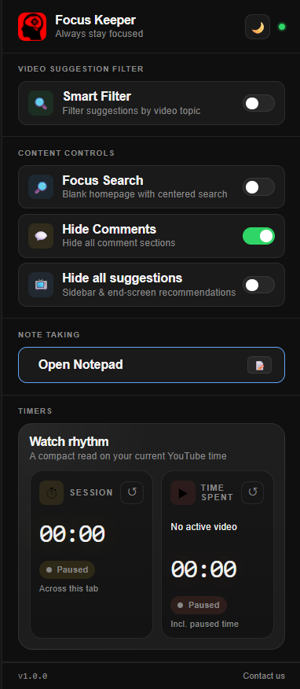
<figcaption>Focus Keeper UI</figcaption>
</figure>

## Smart Filtering Feature

Smart filtering is the most important feature of the Focus Keeper
extension. To use this feature, users first need to click on the
extension icon on the Chrome browser. It will pop open a pop-up window.
There will be a toggle switch available named "Smart Filtering". If the
user clicks on it and toggles the switch on, it will start collecting
information about currently playing videos and videos in the suggestion
list. Then the information will be sent to the backend server by the
background script. On the server side, the bge-m3 embedding model
converts them into vector form and performs cosine similarity on the
current videos and the recommended video. It decides the semantic
similarities. The main job of this feature is to hide those videos from
the recommended list that are not relevant and work as a random
distraction. So it not only does keyword matching, but also actual
semantic meaning. The effect it leaves on the YouTube UI is that it does
not contain random, unrelated, distractive videos from the ui. As a
result, the user only sees those videos that are topic-related. As a
result, the normal recommended system of YouTube becomes an environment
for controlled learning. User has the ability to toggle the switch off
and return to the previously unfiltered videos.

<figure data-latex-placement="h">
<figure>
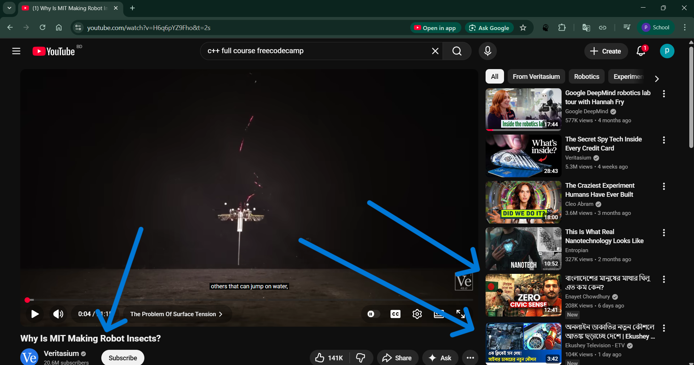
<figcaption>Before turning on the Smart Filtering, irrelevant videos
were appearing</figcaption>
</figure>
<figure>
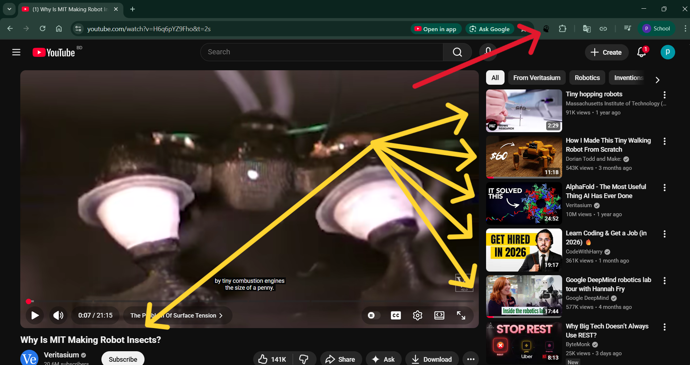
<figcaption>After turning on the Smart Filtering, the suggestion tab
refreshed</figcaption>
</figure>
<figcaption>Before and after screenshot of filtering system</figcaption>
</figure>

## Recommended Videos Toggle

To use the recommended video toggle feature, the user needs to toggle
the switch on which is labeled as the Recommended videos option. This is
different from smart filtering because smart filtering keeps relevant
videos and removes the irrelevant ones, but the recommended switch hides
the recommended panel entirely. This feature mainly works to hide the
full recommended system. When the user is watching an important video,
he/she may not want to see any other videos at that time. In that
scenario, these features work best. It helps to create a fully isolated
system where the user only focuses on the currently playing video and
nothing else. The effect this feature leaves on YouTube UI is that it
completely removes the recommended panel from the ui and helps achieve a
clean interface where the main focus is currently playing video. It
helps reduce visual triggers that happen when a user sees a random
video, even though that video is filtered and relevant to the topic.
This breaks the flow of learning.

{#fig:placeholder width="100%"}

## Comment Section Toggle

To use the Comment Section Toggle, the user will turn ON the Comment
Section option from the extension pop-up. While comments on a YouTube
video page are sometimes useful, they can be a distraction in an
educational context. Sometimes the comments section contains arguments,
unrelated discussions, or spoilers, which disrupt the user's learning
flow. Turning on this feature, the extension detects the DOM element on
the YouTube page and hides it. It does not delete or modify actual
YouTube data; it simply makes the ui invisible to the user interface.
This allows the user to toggle OFF the comment section later if they
wish. The effect it leaves on YouTube ui is that comments will no longer
appear below the video player. Typically, users scroll after playing a
video, which can break the user's learning flow by distracting. This
feature helps prevent that.

<figure data-latex-placement="h">
<figure>
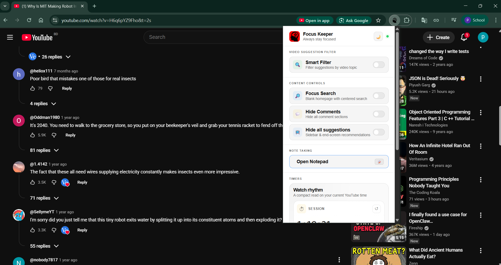
<figcaption>Before remocing comments</figcaption>
</figure>
<figure>
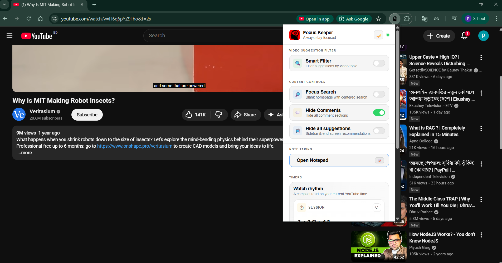
<figcaption>After removing comments</figcaption>
</figure>
<figcaption>Before and after removing comments</figcaption>
</figure>

##  Features

The most important part of the \"Focus Keeper\" extension is its user
interface. It is not only a settings menu, but also a direct interaction
layer between the user and the whole system. The pop-up window is
located in the top-right corner of the browser. In designed in such a
way that the user can change important settings with a single click. The
interface is lightweight and responsive. Instead of heavy graphics,
there are toggle switches, sliders, and clear labeling, which help make
quick decisions. The core functionalities of the extensions are

### Smart Notepad

To use the smart Notepad feature, the user will open the Notepad option
from the popup ui. It is not a typical pop-up window, but a floating
window where relevant notes can be written down. The user can write down
important points, definitions, formulas, commands, summaries, or
personal notes while watching a video. Notes stay persistent even when
closing and switching tabs. The feature is designed to combine video
watching and note-taking in the same interface. Previously, users had to
use a separate text editor. This required switching tabs repeatedly,
which would disrupt focus. Focus Keeper's Smart Notepad comes as a
floating panel on the video page. So users can take notes without
leaving the video. The effect on the YouTube UI is that an additional
floating note panel appears on the page. It does not close the main
YouTube video player. Note-taking support is also available in
full-screen mode.

<figure id="fig:notepad" data-latex-placement="h">
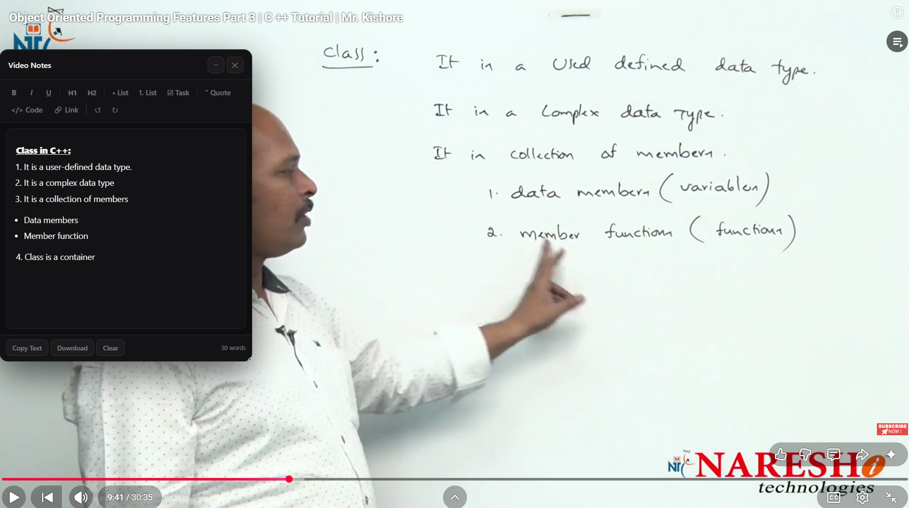
<figcaption>Floating notepad while video is playing</figcaption>
</figure>

### Session and Video Timer

Focus Keeper tracks time at two different levels, making users aware of
their digital habits. There is a session timer and a video timer

**Session timer** tracks the total time spent on YouTube.When the tab is
active, the timer runs. When the user switches to another tab or quits
the application, the timer pauses. The user can reset this session timer
to 0 at any time if they wish.

**Video timer** is more specific than the session timer. It only tracks
the time spent watching a specific video. It gives a clear comparison
between the total watch time of a video and the total YouTube usage.
When someone navigates to a new video, a new timer starts.

<figure id="fig:timer" data-latex-placement="h">
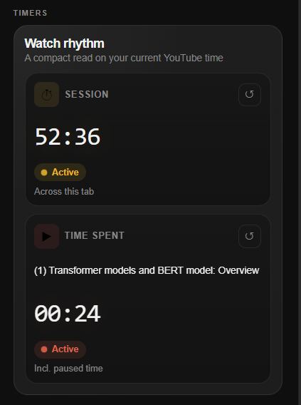
<figcaption>Session timer and Video timer</figcaption>
</figure>

### Dark-Light Mode Compatibility

The theme adaptation feature is an important part of the extension's
UI/UX, even if the user doesn't always manually use it. When YouTube is
in dark mode or light mode, Focus Keeper's floating notepad and pop-up
interface try to adapt to that visual style. The function of this
feature is to make the extension feel like YouTube's native interface.
If the extension's UI is completely different from YouTube's design,
then that can also feel distracting. So, using CSS styling, the notepad,
popup, toggle, text color, and background color are designed in a way
that is consistent with YouTube's current theme. The effect on the
YouTube UI is that the extension doesn't feel like a separate
third-party element. Rather, it feels like it's YouTube's built-in
productivity layer. This smooths the user experience and reduces
interface clutter.

<figure data-latex-placement="h">
<figure>
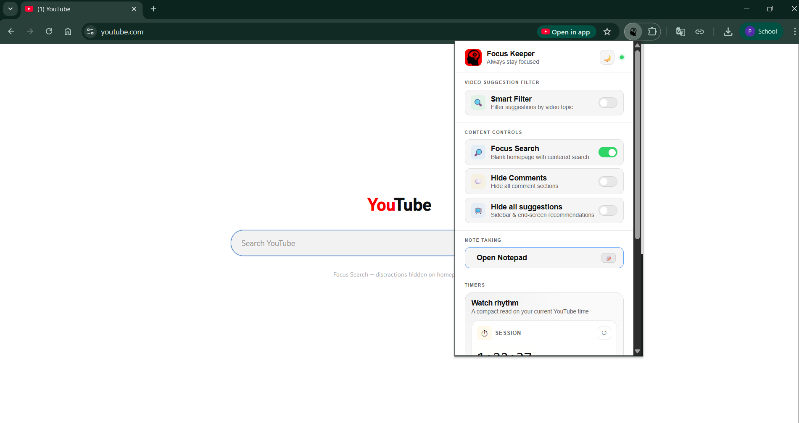
<figcaption>Light mode</figcaption>
</figure>
<figure>
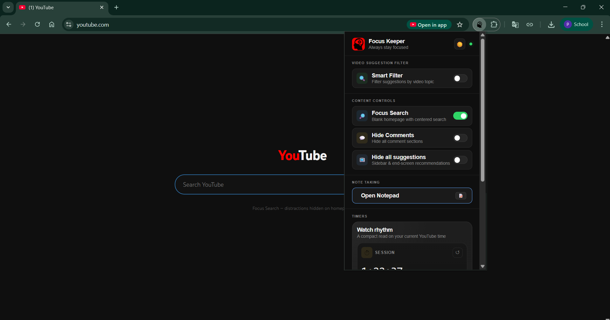
<figcaption>Dark mode</figcaption>
</figure>
<figcaption>Dark-Light Mode Compatibility</figcaption>
</figure>

## Technology Stack and Implementation Details

### Chrome Extension Platform

It is a platform that allows customization of the functionality of the
Chrome-based browser. It is the main thing of interacting directly with
YouTube at the DOM level and manipulating the DOM elements. It helped to
create a seamless user experience and run directly in the browser
without any third-party software.

### Manifest V3

Manifest V3(MV3) is the mandatory and latest configuration for Chrome
extensions. It is designed to improve security, performance, and privacy
by restricting how extensions interact with websites. It helps Focus
Keeper to work in the background in a resource-efficient manner.

### HTML (HyperText Markup Language)

HTML creates the skeleton of our extension's pop-up window and notepad.
It acts as the layout of the user interface in the project. It creates a
user friendly ui that allows simple representation of complex settings.
In the project, vanilla HTML has been used to maintain the lightweight
nature of the extension.

### CSS(Cascading Style Sheets)

Using CSS, the frontend of the extension has given it an attractive
look. It changes the style of the extension to match YouTube's dark and
light modes to give a native look to the user. As a result, the notepad
in the extension feels like a part of YouTube.Here, vanilla CSS is used
to keep the project file smaller.

### JavaScript

The project is mainly done by JavaScript.It operates everything,
including the DOM modification and logic. It handles the functionalitis
need to execute timers in the backend, making api request, creating a
notepad, and saving text inside it. It makes the entire system
interactive. Without JavaScript, none of the project's logic would have
functioned.

### Chrome Extension APIs

Chrome extension APIs like 'chrome.runtime', 'chrome.storage',
'chrome.tabs' bridge the logic to the browser.' chrome.storage' helps to
store data in local storage, whereas 'chrome.tabs' helps to track the
active tabs.'chrome.runtime.onMessage' helps to share data between two
files in the extension. For these APIs, the system can make changes to
YouTube pages in real time and save user settings. Without these, the
extension is just a regular website without any connection to the
browser.

### Node.js

Node.js is the backend runtime environment in the project. It is best an
handling asynchrnous I/O, which is important for getting embeddings from
Sentence Embedding Models. Node.js ensures a high-performance server
with the ability to handle many requests at a time. As on the server
side, the embedding process is heavy, the event-loop of Node.js manages
them very easily.

### Express

Express is a web framework for Node.js.In the project, it handles API
routing and HTTP requests. It is used to create \"/ans\" API endpoint,
which processes AI requests. It keeps the server code clean and allow to
scale easily. The community support and large ecosystem of Express have
made it the first choice to use it in the project.

### REST API

The entire architecture is built around the RESTful standard. It is a
standard communication protocol that acts as a language for
communication between the extension and the server. It modulizes the
entire system, which means if the server changes in the future, the
extension does not have to be changed.

### bge-m3:latest (Embedding Model)

It is a very powerful embedding model that converts text into vectors.
It is a multi-lingual model, which makes it suitable for a YouTube-like
platform. It is used in the project to determine the similarity score.
It understands text from different languages and gives high accuracy
similarity. This gave the project the ability to find meaning matches
instead of keywords. For its multilinguality, moderate accuracy, and
device availability, it becomes the best fit for the project.

### Ollama

Ollama is used as the local interface engine, which runs models directly
on the computer. It is the most important part of the project because it
enables sentence embedding without any external API. This ensures
privacy.

### PM2

It is a production-ready process manager that keeps the server running
at all times. It restarts the server immediately if it crashes and runs
the server in multi-instance mode. It ensures high availability, which
contributes to the scalability of the project. For small and
medium-sized servers, it is a great choice.

### NGINX(Load Balancer)

NGINX works as the reverse proxy and load balancer here.It accepts
external requests and distributes them among the servers powered by PM2.
This effect is that it reduces the traffic to a single server and
increases the scalability of the project. It is a secure gateway to
connect the project's API to the outside world.

## Discussion

In the twenty-first century, the greatest asset of a person is his
\"attention\".But in the digital era, it has become more difficult to
maintain attention. Although platforms like YouTube are great sources of
knowledge and education, their business model mainly depends on keeping
their users busy to consume their service. For this purpose, a powerful
recommendation engine has been created. As a result, a student was
easily distracted by the \"Clickbait\" videos that appeared in the
sidebar of his current video. To solve this problem, Focus Keeper
started its journey to prevent the user from deviating from their main
goal.

## Conclusion

Social media and YouTube algorithms are designed to keep people attached
to them. When a student goes to watch an educational video, the
surrounding clickbait videos distract them from their main goal. Focus
Keeper breaks this \"rabbit hole\". It helps bring society back to a
culture of \"purposeful internet use\".

YouTube is currently the biggest source of free education in Bangladesh
and around the world. But students waste a lot of time due to
distractions. By using Focus Keeper, students will be able to learn more
in less time. Researchers will be able to find information relevant to
their subject faster.

The presence of excess information and irrelevant videos creates extra
pressure or 'Cognitive Load' on our brains. This is one of the reasons
for the lack of attention and mental fatigue. Focus Keeper helps to keep
our brains calm and focused on deep work by filtering out unnecessary
content. This increases the mental peace and performance of users in the
long run.

The development of any country requires skilled and focused manpower.
When professionals watch tutorials on YouTube, Focus Keeper saves them
valuable time. Time saved means economic prosperity. Thus, this tool
indirectly contributes to national productivity.

The current version of Focus Keeper has laid a strong foundation.
However, as technology improves, its potential is even greater.
Currently, it only analyzes the title of the video. In the future, there
is scope to analyze the thumbnail and transcript and give the result
according to them.

For underage YouTube consumers, a dashboard can be made for their
parents to monitor their content consumption. The parent will be able to
monitor and enforce rules for content consumption.

The extension is currently limited to the Chrome browser only. In the
future, it can be extended to mobile applications and other platforms.

Rewards can be given based on how long the user watches the video with
attention. This will create a kind of incentive for users to study.
There will also be an analytics graph that will show what the user's
focus level was over the past week.

# Societal, Health, Environment, Safety, Ethical, Legal and Cultural Issues

## Intellectual Property Considerations

This project is mainly built in combination with a Chrome Extension and
a backend system, where it works on the YouTube platform. The
intellectual property here is an important subject because the content
of YouTube (video, thumbnail, title) is entirely owned by the platform.
Focus Keeper does not copy or change any content directly. It only
collects data from the DOM, and depending on the data, it makes a
decision on which content to show and which to hide. For this reason,
the project maintains "Read-Only Interaction" and does not infringe
copyright in any way. In addition, the model (such as bge-m3) used for
embedding the sentence and the other tools that are open-source are used
according to their own licenses. In the future, when this project may be
taken to the production level, it will be important to verify the
license of each library and model.

## Ethical Considerations

The main goal of this project is to increase the attention of the user
and reduce unnecessary distractions, which is an ethically positive
initiative. In today's digital world, where the attention economy is a
pretty huge deal, Focus Keeper does not force users to interact with
unnecessary content but rather helps them view content according to
their goal. However, an important ethical concern is user freedom. The
user's decision can be influenced by any AI-based filtering system.
Keeping that in mind, this project kept user control as the main
priority. For example, it enables users to use a different toggle system
so that they can turn off filtering if they want. If we view it from an
ethical perspective, this transparency and user control are very, very
important.

## Safety Considerations

This system does not collect any sensitive data like passwords, personal
information, or browsing history. This only collects video title and
suggestion data, which is completely safe. But because there is
server-based processing, the network configuration becomes an important
topic. For that reason, API configuration needs to be secured by using
HTTP. In addition, lightweight architecture has been used to ensure that
the system does not inject malicious scripts or degrade the browser's
performance.

## Legal Considerations

If we consider the legal point of view, this project is built in
compliance with the Chrome Extension policy and YouTube's Terms of
Service. The system does not modify actual data that is present on
YouTube's own server or database; rather, it only changes the user-side
visualization. That is completely acceptable for browser extensions.
However, in the future, if this project is intended to be used as a
commercial product, then the policy of Google Chrome Web Store and
YouTube API usage needs to be followed strictly. Consideration of the
legal restrictions, especially in the case of automated content
filtering and scraping, is very important.

## Impact of the Project on Societal, Health, and Cultural Issues

Focus Keeper can influence society in a positive way because it directs
people to "Purpose-Driven Internet Usage". In today's world, most of the
students face the problem that they come to YouTube to learn something,
but they drift away into watching other content. This project provides a
solution to this specific problem. Considering the health-related side,
it can reduce cognitive load. It reduces mental fatigue by hiding
unnecessary videos and comments, and helps to focus on deep work.
Culturally, it can leave an impact where people will prioritize learning
over entertainment. It can help in building a long-lasting, productive
digital culture.

## Impact of Project on the Environment and Sustainability

This project does not have any direct negative impact on the environment
because it is a software-based solution. Rather indirectly, it can leave
a positive impact. Because it reduces the wastage of users' time and
improves the ability to work productively, the usage of digital
resources is justified. As it is a lightweight extension, the
computational power is low, which reduces the energy consumption. In the
future, if the system is deployed on a large scale, server optimization
and the use of energy-efficient architecture will be important to ensure
sustainability.

# Addressing Complex Engineering Problems and Activities

## Complex engineering problems associated with Focus Keeper

There were some hard engineering problem which were very difficult to
solve. Firstly, YouTube's dynamic DOM structure was a big problem
because it keeps on changing. As a result, data extraction using a
content script becomes hard. That's why MutualObserver is used for
real-time monitoring. Secondly, it was a hard task to implement semantic
filtering. The accuracy with only keyword matching is not good, so it
was necessary to work with sentence embedding and cosine similarity.
Using a proper threshold value was also a challenging task because
setting too high a threshold value could cause the hiding of relevant
videos, and setting too low a threshold value could cause in not
filtering the irrelevant videos. Thirdly, managing the client-server
communication and asynchronous processing was an important engineering
challenge. That is because the ui could freeze due to the embedding
computation being heavy if it were synchronous. So an asynchronous API
call and a background worker are used to solve this issue.

## Complex engineering activities associated with Focus Keeper

This project completed many complex engineering activities, which are a
must for creating a complete software system. To ensure scalability and
maintainability, the system architecture is designed into three layers
(Frontend, Client backend, Server). All phases of the Software
Development Life Cycle (SDLC) are followed during the development of
this system. In the backend, Node.js, Express.js, embedding model
integration, and load balancing (NGINX) are used to make sure the system
is scalable. At the same time, by using the PM2, it is ensured that the
process is managed efficiently. Finally, testing and debugging were a
big part of the development. Extension was used in different browser
scenarios to examine and optimize the performance of the extension.

# Conclusions

## Summary

Focus Keeper is an intelligent productivity tool that was developed
while keeping in mind the fact that it should increase learning
efficiency by reducing YouTube distractions. This project only shows the
relevant videos by using a semantic search done by the Chrome extension
and backend server together. Also, the integration of notepad and timer
makes users' work easier and more structured. Modern technologies like
sentence embedding, REST APIs, and scalable architecture make this
project a solution to real-world problems.

## Limitations

There are some limitations in the current implementation. Firstly, the
system only finds similarity based on video titles, which can be
inaccurate sometimes. The video thumbnail, transcript, and description
are not taken into consideration at all. Secondly, it is limited to the
Chrome browser. So user with different browsers or mobile phones can not
use this for their distraction prevention. Another problem that can
occur is network latency because of server-based processing.

## Recommendations and Future Works

There is a lot of scope for an upgrade in the future. Firstly, video
transcript and thumbnail analysis can be added to make the semantic
analysis more powerful. Secondly, it can be extended to mobile platforms
and other browsers to increase the user base. Thirdly, an analysis
dashboard can be added where users can observe their focus patterns and
usage statistics. Also, an AI-based recommendation system can be
improved and personalized to make it more intelligent. That could make
it long-lasting and also upgraded into a full-fledged learning
assistant.
